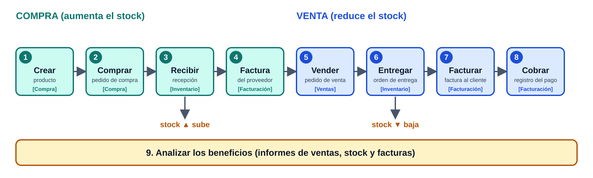

# Tema 7 — El flujo de compra-venta

**Objetivos:** dar de alta un producto · realizar una compra · tramitar la recepción · controlar la facturación (compra y venta) · realizar una venta · entregar un producto · registrar el pago · analizar los beneficios.

---

## 1. Introducción

Es el primer tema en que trabajamos con Odoo **como lo haría el usuario final**. El caso del temario: una **empresa de venta de muebles** con Odoo instalado, que hace un **flujo de compra-venta básico**.

> 💡 Es un flujo *básico*: no se contemplan pedidos que no llegan, devoluciones, facturas rectificativas… Existen muchísimas variables.

---

## 2. Módulos necesarios

Para la simulación necesitamos, al menos, estas aplicaciones:

| Aplicación | Para qué |
|------------|----------|
| **Ventas** | Presupuestos y pedidos de venta |
| **Compra** | Presupuestos y pedidos de compra a proveedores |
| **Inventario** | Recepciones, entregas y stock |
| **Contabilidad / Facturación** | Facturas de proveedor y de cliente, pagos |

> ⚠️ **Contabilidad completa es Enterprise.** En Community usamos **Facturación**, que permite facturar y registrar pagos.

### Pasos del flujo

   

---

## 3. Crear un producto

El jefe de compras quiere comprar a un proveedor un **escritorio**: cuesta **140 €**, pero si compra **10 o más** el precio es **100 €**. Después lo venderán a **220 €**.

**Compra → Productos → Productos → Crear.** Campos importantes:

| Campo | Qué es | Ejemplo |
|-------|--------|---------|
| **Nombre** | Nombre del producto | Escritorio |
| **Imagen** | Foto opcional | |
| **Puede ser vendido** | Aparece en ventas | ✅ |
| **Puede ser comprado** | Aparece en compras | ✅ |
| **Tipo de producto** | Ver tabla siguiente | Almacenable |
| **Precio de venta** | Lo que paga el cliente | 220 € |
| **Impuestos cliente** | IVA aplicado | 21 % |
| **Coste** | Coste a priori | 140 € |

### Tipos de producto

| Tipo | Qué significa |
|------|---------------|
| **Consumible** | No se gestionan las existencias |
| **Servicio** | No material (ej. horas de mano de obra) |
| **Almacenable** | Se gestiona el **stock**. Requiere Inventario instalado |

> 📌 **Odoo 17/18:** los tipos cambian. En Odoo 18 es **Bienes** y se activa la casilla **Rastrear inventario** (equivale a «almacenable»); **Servicio** se mantiene.

### Pestaña Compra: precios por proveedor y cantidad

| Proveedor | Cantidad | Precio |
|-----------|----------|--------|
| Azure Interior | 1 | 140 € |
| Azure Interior | 10 | 100 € |

Al guardar, el producto aparece en la lista con **stock 0**.

---

## 4. Comprar un producto

**Compra → Pedidos → Solicitudes de presupuesto → Crear.**

1. Se informa el **proveedor** y se añade el **producto** y la **cantidad** (10).
2. Odoo aplica el precio según la cantidad: **100 €** (por ser 10 o más).
3. Se pulsa **Confirmar pedido** → se genera la **orden de compra** (ej. P00008).

```
 Presupuesto ──[Confirmar pedido]──► Orden de compra
 (borrador)                           stock AÚN a 0
```

> ⚠️ La orden de compra **no aumenta el stock**: eso ocurre cuando se **recibe** la mercancía.

---

## 5. Caso práctico 1: «El abastecimiento automático»

**Planteamiento:** el escritorio tiene mucha demanda. Queremos que, cuando queden **5**, se haga un **pedido automático** para tener **10** en el almacén.

**Solución:** Odoo permite **reglas de stock mínimo** (reglas de reabastecimiento). Sirven para productos de mucha demanda o de gran tamaño, y nos ahorran el trabajo de reponer.

En el producto → **Reglas de abastecimiento** → Crear:

| Campo | Significado | Ejemplo |
|-------|-------------|---------|
| Producto | A quién se aplica | Escritorio |
| **Cantidad mínima** | Con ella se activa un pedido | 5 |
| **Cantidad máxima** | Hasta cuánto se repone | 10 |
| **Múltiplo de la cantidad** | Pedido mínimo en unidades | 1 |
| Compañía / almacén | Dónde se hace | |
| Plazo de entrega | Cuánto tarda el proveedor | |

```
 stock baja a 5  ──►  el planificador se ejecuta  ──►  orden de compra automática
                      (cada noche a las 00:00)         hasta llegar a 10
```

> 💡 Se puede lanzar a mano: **Inventario → Operaciones → Ejecutar planificador** (en versiones recientes, **Reabastecimiento → Pedir ahora**).

---

## 6. Recibir un producto

Supongamos que el proveedor ya envió el material. Se hace desde **Inventario**:

1. En el resumen aparece la tarjeta **Recepciones → X a procesar**.
2. Buscamos la recepción cuyo **documento de origen** es nuestra orden de compra (P00008).
3. En la parte superior vemos el **estado**:

```
 Borrador ──► En espera ──► Preparado ──► Hecho
                              ▲ aquí está       ▲ tras validar
```

4. Informamos en **Hecho** la cantidad recibida (debe coincidir con lo pedido: 10) y pulsamos **Validar**.

✅ El estado pasa a **Hecho** y el stock del escritorio es **10**.

---

## 7. Control de facturación

Hay que registrar la **factura del proveedor** para llevar bien las cuentas.

1. Contabilidad/Facturación → **Proveedores → Facturas → Crear**.
2. Elegimos el proveedor y, en **Completar automáticamente**, la orden de compra: se rellenan los datos del pedido.
3. **Comprobamos** que el importe coincide con el de la factura que nos envía el proveedor. Si no, hay que contactar con él.

| Concepto | Importe |
|----------|---------|
| 10 escritorios × 100 € (base imponible) | 1 000 € |
| IVA 21 % | 210 € |
| **Total** | **1 210 €** |

> 📌 **Odoo 17/18:** normalmente se pulsa **Crear factura** directamente desde la orden de compra.

Con el producto en stock y la factura guardada, esperamos a los clientes.

---

## 8. Venta y entrega de un producto

### 8.1 Vender
El cliente *Miguel* pide un presupuesto de **2 escritorios** por correo.

```
 Presupuesto ──[Enviar]──► Presupuesto enviado ──[Confirmar]──► Pedido de venta
```

### 8.2 Entregar
**Inventario → Órdenes de entrega** (en versiones recientes, **Entregas**).

1. Abrimos la entrega cuyo **documento de origen** es el pedido de venta (ej. S00023), en estado **Preparado**.
2. Editamos **Hecho** con la cantidad enviada (igual a la demandada) y **Validar**.
3. Estado **Hecho** y el stock baja (de 10 a 8).

---

## 9. Caso práctico 2: «Cancelando un presupuesto»

**Planteamiento:** un cliente pide presupuesto de 1 «Gabinete grande» (coste 320 €) y, al verlo caro, no lo pide.

**Solución:** el presupuesto, además de **Confirmado**, puede quedar **Cancelado**.

```
 Presupuesto ──► Presupuesto enviado ──► Pedido de venta
                        │
                  [Cancelar]
                        ▼
                    CANCELADO
```

1. Abrimos el presupuesto en **Ventas** (aún está en *Presupuesto enviado*).
2. Pulsamos **Cancelar** en lugar de *Confirmar*.
3. El historial de la parte inferior (*chatter*) registra el cambio de estado.

---

## 10. Facturación y registro de pagos

### 10.1 Facturar al cliente
En el pedido de venta vemos: **Cantidad 2 · Entregado 2 · Facturado 0**.

1. Pulsamos **Crear factura**. Opciones: **Factura regular**, **Depósito (porcentaje)** o **Depósito (cantidad fija)**. Elegimos la regular (las otras sirven para facturar solo una parte).
2. Se crea un **borrador**; hay que **publicarla** (*Confirmar* en versiones recientes).
3. Desde ahí se puede **enviar e imprimir** por correo con la factura adjunta.

```
 Borrador ──[Publicar / Confirmar]──► Publicado ──[Registrar pago]──► PAGADO
```

### 10.2 Registrar el pago
Cuando el cliente paga, en la factura pulsamos **Registrar pago** (los campos ya vienen rellenos) y **Validar**. La factura queda como **PAGADO**. El pago se puede registrar desde varios sitios (Ventas o Contabilidad).

### 10.3 Analizar los beneficios
Conviene revisar de vez en cuando los **informes** de la empresa para ver si las decisiones son correctas (ventas, stock, facturas).

---

## 11. Resumen

```
 Para AUMENTAR el stock:   Comprar ──► Recibir ──► Controlar la factura
   (Compra)                  (Inventario)           (Contabilidad)
 Para REDUCIR el stock:    Vender ──► Entregar ──► Facturar ──► Cobrar
   (Ventas)                  (Inventario)         (Contabilidad)
```

| Pregunta | Respuesta corta |
|----------|-----------------|
| ¿Cuándo sube el stock? | Al **validar la recepción**, no al confirmar la compra |
| ¿Cuándo baja? | Al **validar la entrega** |
| ¿Cómo evito quedarme sin stock? | **Regla de reabastecimiento** (mínimo/máximo) |
| ¿Se puede deshacer un presupuesto? | Sí, **Cancelar** |
| ¿Qué módulos intervienen? | Compra, Inventario, Ventas y Contabilidad/Facturación |
